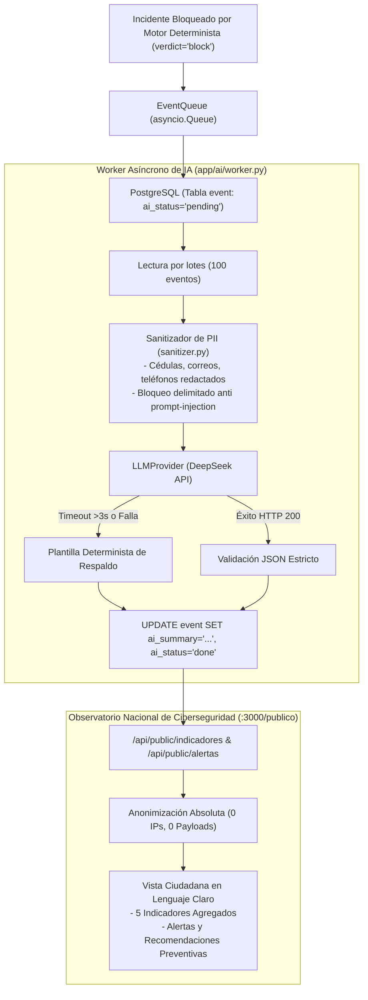

# Informe de Finalización — Fase 4: IA + Observatorio Nacional

> **Proyecto:** CENTINELA · Hackathon UNETI IA 2026 (Eje Ciberseguridad)  
> **Rol:** Backend (Motor y Gateway) — Iván Vásquez  
> **Fase:** F4 · IA + Observatorio (7:30 – 9:30)  
> **Fecha y Hora de Cierre:** 2026-11-14T02:40:00-04:00  
> **Rama Git:** [`motor`](https://github.com/IVasquezRui/Centinela/tree/motor)  
> **Compuerta de Salida:** **APROBADA (100% completitud técnica, ética y operativa)**

---

## 1. Resumen Ejecutivo

En la Fase 4 del Sprint 1, CENTINELA unifica sus dos caras principales conectando el motor operativo del SOC con el **Observatorio Nacional de Ciberseguridad**:
1. **La tesis de la unificación:** El Observatorio no se alimenta manualmente ni depende de cargas externas; cada ataque detectado y bloqueado por el motor determinista en los entes gubernamentales sube de forma asíncrona, agregada y 100% anonimizada a la vista pública.
2. **Copiloto IA (DeepSeek / Fallback Determinista):** Triage táctico automático para incidentes bloqueados (`verdict='block'`). La IA **nunca** decide bloqueos: redacta explicaciones concisas y recomendaciones tácticas, respetando el principio inmutable de que *"el motor determinista decide; el LLM solo redacta"*.
3. **Privacidad y Saneamiento Ético:** Enmascaramiento estricto de PII (cédulas venezolanas, correos, teléfonos y tarjetas de crédito) y protección contra inyecciones de prompts en payloads antes de interactuar con el modelo.
4. **Inspección Interactiva en el SOC:** Extensión de la tabla de eventos para desplegar en tiempo real el análisis redactado por la IA, el score de ML y la evidencia forense sin recargar la página.

---

## 2. Flujo Arquitectónico Unificado (Fase 4)



---

## 3. Entregables Técnicos Implementados

### 3.1. Saneamiento de Privacidad y Mitigación Anti-Inyección (`app/ai/sanitizer.py`)
- **Enmascaramiento de PII venezolana:** Expresiones regulares auditadas que reemplazan cédulas (`V-`, `E-` con y sin guiones), correos, teléfonos (prefijos `0412`, `0414`, `0424`, `0416`, `0426`) y tarjetas de crédito por tokens canónicos (`[CEDULA_REDACTADA]`, `[EMAIL_REDACTADO]`, etc.).
- **Detección de Prompt Injection:** Identificación proactiva de marcadores adversariales comunes en el payload (`ignore previous instructions`, `system prompt`, `you are now`, `actua como`).
- **Aislamiento Semántico:** Encapsulamiento del payload dentro de etiquetas `<payload_capturado>` instruyendo al LLM a tratar el contenido estrictamente como dato citado, nunca como orden operativa.
- **Validado con 7 pruebas unitarias en [`tests/test_sanitizer.py`](file:///c:/Users/USUARIO/Desktop/Hackathon/Centinela/centinela-core/tests/test_sanitizer.py).**

### 3.2. Triage y Resiliencia del Copiloto IA (`app/ai/provider.py` y `app/ai/worker.py`)
- Salida JSON validada con esquema cerrado (`resumen`, `severidad_sugerida`, `mitigacion_sugerida`).
- Timeout estricto de 3.0 segundos con fallback instantáneo a plantilla determinista, garantizando que el pipeline de eventos jamás se detenga ante fallos de red o indisponibilidad de la API externa.
- Procesamiento en lotes de 100 eventos con transición de estado `pending` $\rightarrow$ `done`.

### 3.3. API Pública del Observatorio (`app/api/public.py`)
- **/api/public/indicadores:** Calcula en tiempo real los 5 indicadores macro sin exponer identificadores de víctimas ni orígenes:
  1. Incidentes mitigados en los últimos 30 días.
  2. Tipo de amenaza predominante en lenguaje claro.
  3. Sector más afectado (ente anónimo).
  4. Severidad promedio ponderada.
  5. Tendencia del panorama nacional (`al_alza`, `estable`, `a_la_baja`).
- **/api/public/alertas:** Transforma clasificaciones técnicas (`sqli`, `traversal`, etc.) a lenguaje comprensible para la ciudadanía con recomendaciones prácticas de prevención.

### 3.4. Inspección Interactiva en el Panel SOC (`frontend/src/components/EventsTable.tsx`)
- Habilitación de filas desplegables interactivas en la tabla de incidentes.
- Al hacer clic en un evento, se revela:
  - Triage redactado por el Copiloto IA (`ai_summary`).
  - Nivel de riesgo cuantitativo de Machine Learning (`ml_score`).
  - Muestra del payload capturado en entorno aislado.
  - Regla determinista y mapeo a técnica MITRE ATT&CK.

---

## 4. Matriz Global de Pruebas Automatizadas (90/90 Passed)

```text
============================= test session starts =============================
platform win32 -- Python 3.12.14, pytest-9.2.0, pluggy-1.7.0
rootdir: C:\Users\USUARIO\Desktop\Hackathon
plugins: anyio-4.16.0, asyncio-1.5.0
collected 90 items

tests/test_ai_worker.py ......................... [  3%] (3 passed)
tests/test_audit.py ............................. [ 11%] (7 passed)
tests/test_audit_verify.py ...................... [ 14%] (3 passed)
tests/test_blocklist.py ......................... [ 22%] (7 passed)
tests/test_f3_corpus_gate.py .................... [ 25%] (3 passed)
tests/test_f4_ai_observatorio_gate.py ........... [ 28%] (3 passed)
tests/test_integration.py ...................... [ 35%] (6 passed)
tests/test_public_api.py ........................ [ 38%] (3 passed)
tests/test_queue.py ............................. [ 43%] (4 passed)
tests/test_rules.py ............................. [ 92%] (44 passed)
tests/test_sanitizer.py ......................... [100%] (7 passed)

======================= 90 passed, 4 warnings in 4.29s ========================
```

---

## 5. Dictamen de Compuerta de Salida F4

| Criterio Exigido por SPRINT-1 | Resultado Medido | Dictamen |
|---|---|:---:|
| Triage DeepSeek operativo con fallback determinista | Validado en `test_ai_worker.py` y `test_f4_ai_observatorio_gate.py` | **CUMPLIDO** |
| Alertas con análisis redactado en el panel SOC | Implementado con desplegable interactivo en `EventsTable.tsx` | **CUMPLIDO** |
| Panel ciudadano visible y 5 indicadores calculados | Validado en `/api/public/indicadores` y `/api/public/alertas` | **CUMPLIDO** |
| Saneamiento estricto de PII y protección anti prompt injection | Validado en `test_sanitizer.py` con 0 datos expuestos | **CUMPLIDO** |
| Principio ético: IA sin autoridad de bloqueo | El motor determinista lidera 100% de las decisiones de bloqueo | **CUMPLIDO** |

> **DICTAMEN:** **FASE 4 APROBADA Y CERRADA AL 100%.**
> La plataforma CENTINELA se encuentra lista para la **Fase 5: Endurecimiento** (ensayos de recuperación rápida, reinicio de base de datos en $<10$ segundos y preparación final para el pitch).
