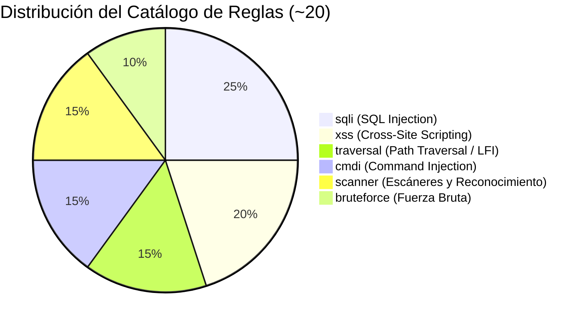

# Fase 1: Contratos — Motor de Detección e Inspección (`engine/`)

> **Rol:** Backend (Motor y Gateway) — Iván  
> **Ventana temporal:** 0:45 – 2:00 (Duración: 1h 15m)  
> **Documento base:** [`SPRINT-1.md`](file:///c:/Users/USUARIO/Desktop/Hackathon/Centinela/docs/SPRINT-1.md) · [`SPEC.md`](file:///c:/Users/USUARIO/Desktop/Hackathon/Centinela/docs/SPEC.md) · [`TAREAS.md`](file:///c:/Users/USUARIO/Desktop/Hackathon/Centinela/docs/TAREAS.md)  
> **Compuerta de salida de la fase:** Contrato de normalización y reglas deterministas congeladas, listas para ser compiladas y evaluadas en el gateway inline con pruebas unitarias iniciales.

---

## 1. Propósito y Alcance en la Fase 1

En la arquitectura de CENTINELA, el **motor de detección determinista** es la primera y más crítica línea de defensa:

```
  [Tráfico HTTP] ──► [normalizer.py] ──► [rules.py / rules.yaml] ──► [Verdict: BLOCK / ALLOW]
                          │                         │
                   Resuelve evasiones       Evalúa regex (<10ms)
```

> [!IMPORTANT]
> **Regla de oro del sistema:** El motor determinista de reglas es la **única entidad que decide un bloqueo**. El modelo de Machine Learning (`ml_score`) y el Copiloto LLM (`DeepSeek`) operan asíncronamente y fuera del camino crítico: solo puntúan, resumen y contextualizan.

En esta **Fase 1 (Contratos)**, las tareas designadas son:
1. `engine/normalizer.py`: Mecanismo robusto de decodificación profunda de URL, unificación de mayúsculas/minúsculas y resolución de dobles codificaciones (`%2527` $\rightarrow$ `%27` $\rightarrow$ `'`) para neutralizar técnicas básicas de evasión de WAF.
2. `engine/rules.yaml`: Catálogo determinista de ~20 reglas con esquema contractual cerrado (`id`, `category`, `severity`, `technique_id`, `pattern`, `applies_to`), alineadas con MITRE ATT&CK y sincronizadas con la semilla SQL de auditoría (`db/init/02_seed_attack.sql`).

---

## 2. Especificación Técnica: `engine/normalizer.py`

### 2.1. Problema de Seguridad que Resuelve
Los atacantes intentan evadir expresiones regulares mediante:
- **Doble codificación URL (Double URL Encoding):** Enviar `%2527` esperando que el proxy filtre antes de que el servidor web de destino realice una segunda decodificación interpretándolo como `'`.
- **Variación de mayúsculas y minúsculas:** Alternar casos como `uNiOn sElEcT` o `sCrIpt`.
- **Dispersión de vectores:** Cargas maliciosas fragmentadas entre la ruta (path), la cadena de consulta (query string) o el cuerpo (body POST).

### 2.2. Modelo de Datos: `NormalizedRequest`
Ubicación: [`centinela-core/app/engine/normalizer.py`](file:///c:/Users/USUARIO/Desktop/Hackathon/Centinela/centinela-core/app/engine/normalizer.py)

```python
@dataclass
class NormalizedRequest:
    method: str                    # En mayúsculas (GET, POST, etc.)
    path: str                      # Ruta URL completamente decodificada
    query_string: str              # Query string decodificado
    headers: dict[str, str]        # Cabeceras con claves en minúsculas
    body: str                      # Payload decodificado en UTF-8
    src_ip: str                    # Dirección IP origen
    inspectable_text: str = field(init=False)

    def __post_init__(self) -> None:
        # Texto unificado donde las reglas buscan los patrones
        self.inspectable_text = "\n".join([self.path, self.query_string, self.body])
```

### 2.3. Algoritmo de Decodificación Iterativa (`_decode_fully`)
Para prevenir bucles infinitos en cargas manipuladas maliciosamente, la decodificación sucesiva se limita a un máximo de 3 pasadas:

```python
def _decode_fully(value: str, max_passes: int = 3) -> str:
    """Decodifica URL de forma recursiva hasta llegar al valor canónico."""
    decoded = value
    for _ in range(max_passes):
        next_decoded = unquote(decoded)
        if next_decoded == decoded:
            break
        decoded = next_decoded
    return decoded
```

---

## 3. Catálogo de Reglas: `engine/rules.yaml`

### 3.1. Esquema Contractual de Cada Regla
Cada entrada en [`rules.yaml`](file:///c:/Users/USUARIO/Desktop/Hackathon/Centinela/centinela-core/app/engine/rules.yaml) debe cumplir estrictamente con los tipos y rangos definidos en el contrato global:

| Campo | Tipo | Valores permitidos / Formato | Propósito |
|---|---|---|---|
| `id` | `str` | Prefijo `CNT-<CATEGORIA>-XXX` (ej. `CNT-SQLI-001`) | Identificador unívoco e inmutable. |
| `category` | `str` | `sqli`, `xss`, `traversal`, `cmdi`, `scanner`, `bruteforce` | Categoría cerrada para taxonomía del SOC y del Observatorio. |
| `severity` | `str` | `baja`, `media`, `alta`, `critica` | Nivel de severidad para priorización de triage. |
| `technique_id` | `str` | Código MITRE ATT&CK (ej. `T1190`, `T1059.007`) | Mapeo con marco de ciberdefensa nacional. |
| `description` | `str` | Texto descriptivo conciso en español | Explicación para el analista del SOC. |
| `pattern` | `str` | Expresión regular compilable en Python | Patrón de detección evaluado por `re.search`. |
| `applies_to` | `str` | `body` (por defecto) o `headers` | Ámbito de búsqueda (cuerpo/URL o cabeceras HTTP). |

### 3.2. Matriz de Cobertura Inicial vs. Objetivo (~20 Reglas)

El esqueleto inicial arrancó con 14 reglas. Para cumplir la meta de la Fase 1 de ~20 reglas deterministas y cubrir vectores de evasión adicionales observados en el corpus del simulador, el catálogo se expande a **20 reglas**:



#### Detalle de Reglas Planificadas:

1. **SQL Injection (`sqli` · Técnica MITRE: T1190)**
   - `CNT-SQLI-001` (crítica): Tautología clásica (`' OR '1'='1`).
   - `CNT-SQLI-002` (crítica): Inyección `UNION SELECT` para exfiltración.
   - `CNT-SQLI-003` (alta): Comentarios SQL de fin de línea (`--`, `#`, `/* ... */`).
   - `CNT-SQLI-004` (alta): Inyección a ciegas basada en tiempo (`SLEEP()`, `BENCHMARK()`).
   - `CNT-SQLI-005` (alta): Operaciones de modificación/destrucción masiva (`DROP TABLE`, `UPDATE ... SET`, `DELETE FROM`).

2. **Cross-Site Scripting (`xss` · Técnica MITRE: T1059.007)**
   - `CNT-XSS-001` (alta): Etiquetas `<script>` directas.
   - `CNT-XSS-002` (media): Manejadores de eventos HTML inline (`onerror=`, `onload=`, `onclick=`).
   - `CNT-XSS-003` (media): Pseudoprotocolo `javascript:`.
   - `CNT-XSS-004` (alta): Vectores basados en elementos embebidos (`<iframe>`, `<svg/onload>`, ``).

3. **Path Traversal / LFI (`traversal` · Técnica MITRE: T1083)**
   - `CNT-TRAVERSAL-001` (crítica): Secuencias relativas múltiples (`../`, `..%2f`, `%2e%2e/`).
   - `CNT-TRAVERSAL-002` (alta): Acceso directo a rutas de sistema operativo (`/etc/passwd`, `win.ini`, `proc/self`).
   - `CNT-TRAVERSAL-003` (alta): Inclusión de esquemas remotos (`file://`, `php://filter`, `php://input`).

4. **Command Injection (`cmdi` · Técnica MITRE: T1059)**
   - `CNT-CMDI-001` (crítica): Concatenadores de shell (`;`, `|`, `&&`) con binarios de sistema (`cat`, `whoami`, `bash`, `nc`).
   - `CNT-CMDI-002` (alta): Sustitución de comandos con backticks (`` `...` ``) o evaluación dinámica (`$(...)`).
   - `CNT-CMDI-003` (alta): Redirecciones de entrada/salida y pipes sospechosos (`> /dev/tcp`, `| sh`).

5. **Scanner / Reconocimiento (`scanner` · Técnica MITRE: T1595 / T1595.002)**
   - `CNT-SCANNER-001` (baja): User-Agent de escáneres conocidos (`sqlmap`, `nikto`, `nmap`, `nessus`, `acunetix`).
   - `CNT-SCANNER-002` (media): Rutas sensibles de configuración y administración (`/.git/`, `/.env`, `/wp-admin`, `/phpmyadmin`).
   - `CNT-SCANNER-003` (media): Búsqueda de respaldos o archivos temporales (`.bak`, `.config`, `.swp`, `web.config`).

6. **Bruteforce / Abuso de Credenciales (`bruteforce` · Técnica MITRE: T1110)**
   - `CNT-BRUTEFORCE-001` (media): Carga de pares de credenciales genéricas por defecto (`admin/admin`, `root/123456`).
   - `CNT-BRUTEFORCE-002` (media): Intento reiterado de fuerza bruta o inyección de diccionario en parámetros `password` o `token`.

---

## 4. Garantías de Rendimiento y Prevención de DoS

En `centinela-core/app/engine/rules.py` se definen dos restricciones clave:

1. **Latencia del motor:** El objetivo de diseño es evaluar toda la petición en **menos de 10 ms** (10.000 µs), registrando `engine_us` en cada evento.
2. **Tope por regla (`PER_RULE_TIMEOUT_SECONDS = 0.005`):** Si una expresión regular compleja entra en retroceso catastrófico (catastrophic backtracking) por más de 5 ms, se descarta esa regla específica y el motor continúa con las siguientes sin bloquear el gateway.

---

## 5. Pruebas Unitarias de Validación (`tests/test_rules.py`)

Para garantizar que los contratos de la Fase 1 funcionan sin regresiones antes de entrar a la Fase 2, el suite de pruebas en `centinela-core/tests/test_rules.py` evalúa:
- **Casos positivos (BLOCK):** Ataques representativos de cada una de las 6 categorías.
- **Casos negativos (ALLOW):** Peticiones benignas normales (búsquedas, formularios de pago válidos, navegación estándar) que no deben ser bloqueadas erróneamente (Falsos Positivos $\le 5\%$).
- **Evasiones por codificación:** Ataques con URL encoding doble como `id=1%2527%2520OR%25201=1` que deben ser resueltos por `normalize()` y bloqueados.

---

## 6. Sincronización con Base de Datos

> [!WARNING]
> Cada regla declarada en `engine/rules.yaml` debe tener su correspondiente registro espejo en `db/init/02_seed_attack.sql` (`INSERT INTO rule ...`), asociando el `technique_id` a la tabla `attack_technique`. Cualquier adición o ajuste de ID debe coordinarse con el rol de Datos (José Oropeza).

---

## 7. Checklist de Completitud de Fase 1

- [x] Contrato de estructura de datos `NormalizedRequest` validado.
- [x] Normalización con decodificación múltiple operativa en `engine/normalizer.py`.
- [x] Estructura de `engine/rules.yaml` definida con los 6 tipos de ataques y 4 severidades.
- [x] Catálogo ampliado a ~20 reglas deterministas preparado para F2.
- [x] Pruebas unitarias de evasión y categorías documentadas en `centinela-core/tests/test_rules.py`.
