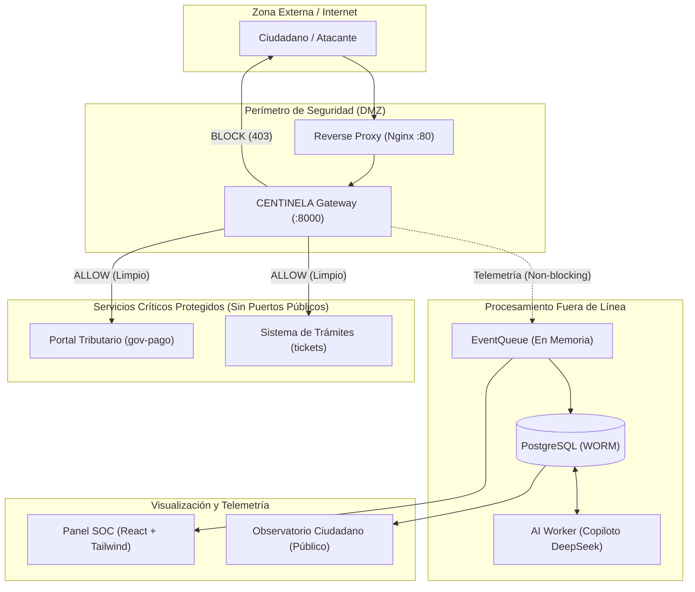
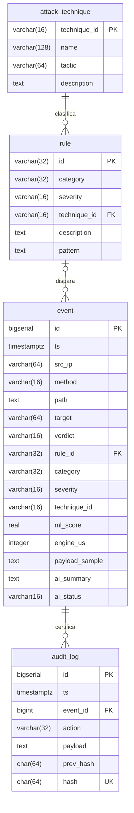

# Especificación de Requisitos de Software (SRS)
## Proyecto: CENTINELA — Sistema Inteligente de Detección, Triaje y Auditoría de Ciberataques
**Estándar:** IEEE Std 830-1998 / ISO/IEC/IEEE 29148:2018  
**Contexto:** Hackathon UNETI IA 2026 · Eje Ciberseguridad y Soberanía Tecnológica  
**Fusión:** Proyectos de Biblioteca UNETI #23 (IDS/IPS Gubernamental) y #40 (Observatorio Nacional de Ciberseguridad)  
**Versión:** 1.0 (Línea Base Post-Sprint 1)  
**Fecha:** 14 de Noviembre de 2026  
**Estado:** Aprobado / Verificado  

---

## 1. Introducción

### 1.1 Propósito
El propósito de este documento de Especificación de Requisitos de Software (SRS) es definir formal, completa e inequívocamente los requisitos funcionales, no funcionales, interfaces externas y restricciones arquitectónicas del sistema **CENTINELA**. Está dirigido al equipo de ingeniería de software, analistas de ciberseguridad (Blue Team), evaluadores del jurado del Hackathon UNETI IA 2026 y futuros administradores de infraestructura crítica del Estado.

### 1.2 Alcance del Sistema
CENTINELA es una plataforma de defensa perimetral e inteligencia de amenazas en capa de aplicación (Capa 7 OSI / HTTP) concebida para salvaguardar portales y servicios transaccionales gubernamentales. El sistema unifica dos capacidades complementarias:
1. **Subsistema Defensivo Perimetral (SOC / IDS / IPS):** Un gateway *reverse proxy inline* que intercepta el tráfico HTTP entrante, normaliza peticiones, aplica un motor determinista de alta velocidad ($< 10\text{ ms}$), activa cuarentenas reactivas de direcciones IP, genera telemetría asíncrona con *Machine Learning*, clasifica incidentes mediante un copiloto LLM seguro (DeepSeek) y registra cada acción en una bitácora inmutable criptográfica protegida mediante permisos WORM (*Write Once, Read Many*).
2. **Subsistema de Inteligencia Ciudadana (Observatorio Nacional):** Un portal público desprovisto de mecanismos de autenticación que consolida, agrega y anonimiza la telemetría operativa en tiempo real, publicando indicadores macro y tendencias de ciberataques en lenguaje accesible para la toma de decisiones ciudadana y estatal, sin exponer jamás información privada ni vectores de explotación.

### 1.3 Definiciones, Acrónimos y Abreviaturas
* **ADR:** *Architecture Decision Record* (Registro de Decisiones de Arquitectura).
* **ATT&CK:** *Adversarial Tactics, Techniques, and Common Knowledge* (Matriz de MITRE).
* **DML / DDL:** *Data Manipulation Language* / *Data Definition Language*.
* **FPR:** *False Positive Rate* (Tasa de Falsos Positivos).
* **Gateway Inline:** Dispositivo o proxy intermediario en el canal de comunicación que procesa y filtra el tráfico antes de reenviarlo al servidor de destino (*upstream*).
* **IPS / IDS:** *Intrusion Prevention System* / *Intrusion Detection System*.
* **LLM:** *Large Language Model* (Modelo de Lenguaje Extenso).
* **PII:** *Personally Identifiable Information* (Información de Identificación Personal).
* **ReDoS:** *Regular Expression Denial of Service* (Denegación de servicio por expresiones regulares catastróficas).
* **SLA:** *Service Level Agreement* (Acuerdo de Nivel de Servicio).
* **SOC:** *Security Operations Center* (Centro de Operaciones de Seguridad).
* **SSE:** *Server-Sent Events* (Eventos Enviados por el Servidor para telemetría unidireccional en tiempo real).
* **WORM:** *Write Once, Read Many* (Propiedad de almacenamiento inmutable).

### 1.4 Referencias
1. IEEE Std 830-1998, *IEEE Recommended Practice for Software Requirements Specifications*.
2. ISO/IEC/IEEE 29148:2018, *Systems and software engineering — Life cycle processes — Requirements engineering*.
3. MITRE ATT&CK Enterprise Matrix v14.
4. Ficha Técnica de Proyecto UNETI #23: *IDS/IPS para redes gubernamentales con corpus NSL-KDD*.
5. Ficha Técnica de Proyecto UNETI #40: *Observatorio nacional de ciberseguridad ciudadana*.
6. Arquitectura y Código Fuente: Repositorio Oficial `CENTINELA` (Rama `develop`).

### 1.5 Descripción General del Documento
El resto del documento se estructura en:
* **Sección 2:** Perspectiva general del producto, funciones principales, usuarios objetivo y restricciones de diseño.
* **Sección 3:** Requisitos específicos detallados (Interfaces, Requisitos Funcionales RF-01 al RF-14, Requisitos No Funcionales RNF-01 al RNF-06 y Requisitos de Base de Datos).
* **Sección 4:** Criterios de aceptación y matriz de verificación formal.
* **Sección 5:** Apéndices técnicos (Mapeo MITRE ATT&CK y Modelado Criptográfico).

---

## 2. Descripción General

### 2.1 Perspectiva del Producto
CENTINELA opera como un centinela perimetral dentro de una topología de microservicios contenerizada en Docker Compose. Se posiciona como único punto de entrada público (puerto `80/443` a través de un reverse proxy perimetral) protegiendo redes privadas aisladas (`centinela-dmz`) donde residen los sistemas objetivos vulnerables (`gov-pago`, `tickets`). Los sistemas protegidos no exponen puertos hacia el host exterior y solo son accesibles si la petición es declarada legítima (`verdict='allow'`).

### 2.2 Funciones Principales del Sistema
1. **Normalización e Inspección Exhaustiva:** Descodificación multinivel de URLs, eliminación de secuencias nulas, estandarización de mayúsculas/minúsculas y evaluación de metacaracteres.
2. **Filtrado Determinista en Submilisegundos:** Cotejo contra 20 reglas precompiladas que bloquean ataques de inyección SQL (SQLi), Cross-Site Scripting (XSS), inclusión de ficheros (LFI/Path Traversal), inyección de comandos OS (CmdI), SSRF y abuso de protocolos.
3. **Cuarentena Reactiva Automatizada (Modo IPS):** Detección de ráfagas maliciosas (3 o más infracciones en 60 segundos por IP) y bloqueo inmediato por 300 segundos sin consumir ciclos de CPU en el motor de reglas.
4. **Puntuación Auxiliar por Machine Learning:** Estimación asíncrona de anomalías mediante clasificador Random Forest entrenado sobre NSL-KDD, actuando como señal de apoyo sin capacidad de veto sobre el tráfico legítimo.
5. **Triaje y Síntesis Asistida por IA:** Generación automática de explicaciones forenses y recomendaciones de contención en español mediante DeepSeek, previa sanitización algorítmica de datos sensibles (cédulas, tarjetas, credenciales).
6. **Bitácora Inmutable y Verificación Forense:** Encadenamiento criptográfico continuo SHA-256 de cada evento y verificación matemática de integridad ante intentos de alteración o borrado de filas.
7. **Divulgación de Indicadores Públicos:** Exposición de métricas consolidadas (tendencia, volumen, efectividad, severidad promedio) resguardando el 100% de la identidad de las víctimas y atacantes.

### 2.3 Características de los Usuarios
* **Operador / Analista SOC (Nivel 1 y 2):** Personal técnico con conocimientos de ciberseguridad que requiere supervisión en vivo del tráfico, alertas priorizadas por severidad y sugerencias de remediación estructuradas.
* **Oficial de Seguridad de la Información (CISO) / Auditor de TI:** Requiere trazabilidad absoluta, garantías matemáticas de no repudio de la bitácora y métricas de cumplimiento de SLA.
* **Ciudadano / Decisor de Políticas Públicas:** Usuario no autenticado que consulta el Observatorio Nacional para conocer el estado de la ciberseguridad nacional en lenguaje claro y accesible.

### 2.4 Restricciones de Diseño e Implementación
* **C1 (Aislamiento de Camino Crítico):** Ninguna petición entrante puede pausar su evaluación esperando respuestas de modelos de lenguaje (LLM) externos ni consultas síncronas a base de datos.
* **C2 (Restricción de Recursos y Privilegios en BD):** La aplicación en tiempo de ejecución debe operar bajo el rol `centinela_app` sin permisos `DELETE`, `TRUNCATE` ni `UPDATE` estructural.
* **C3 (Privacidad Soberana de Datos):** Ningún dato PII real puede ser utilizado en pruebas de laboratorio; los sistemas protegidos operan exclusivamente con datos sintéticos.
* **C4 (Inmunidad ReDoS):** Todas las expresiones regulares deben ser de tiempo lineal $O(N)$ y validadas contra ataques de denegación de servicio por expresiones regulares.

---

## 3. Requisitos Específicos

### 3.1 Requisitos de Interfaces Externas

#### 3.1.1 Interfaces de Usuario
* **IU-01 (Panel SOC):** Interfaz SPA con actualización reactiva por Server-Sent Events (SSE), soporte de temas Claro/Oscuro, filtrado multicriterio de eventos y mapa de calor de severidad vs categoría de ataque.
* **IU-02 (Observatorio Ciudadano):** Vista web abierta, responsive y accesible (WCAG AA), que muestra 5 tarjetas de indicadores y gráficos de tendencias sin requerir credenciales.

#### 3.1.2 Interfaces de Hardware y Red
* **IR-01:** Conectividad de red mediante protocolo TCP/IP, soportando peticiones HTTP/1.1 y HTTP/2 sobre puertos estándar 80 (HTTP) y 443 (HTTPS).
* **IR-02:** Despliegue sobre arquitectura x86_64 o ARM64 con un mínimo de 2 núcleos de CPU y 4 GB de memoria RAM.

#### 3.1.3 Interfaces de Software
* **IS-01 (Motor de Persistencia):** PostgreSQL versión 15 o 16 utilizando el controlador asíncrono `asyncpg`.
* **IS-02 (Proveedor de IA):** API REST compatible con OpenAI / DeepSeek (`https://api.deepseek.com/chat/completions`) mediante protocolo HTTPS y cabeceras Bearer Token.

---

### 3.2 Requisitos Funcionales (RF)

#### Subsistema 1: Normalización, Inspección y Gateway (Núcleo)
* **RF-01 (Normalización de Petición HTTP):**
  * El sistema DEBE decodificar secuencias URL-encoded simples y múltiples (ej. `%252e%252e%252f` $\to$ `../`).
  * El sistema DEBE estandarizar la ruta (*path*) y cadena de consulta (*query string*) a minúsculas para cotejo insensible a mayúsculas.
  * El sistema DEBE extraer y decodificar el cuerpo de la petición (*body*) si su tamaño es inferior a 1 MB.
* **RF-02 (Evaluación Determinista de Reglas):**
  * El motor DEBE cotejar la petición normalizada contra el catálogo de 20 reglas precompiladas.
  * El motor DEBE retornar un objeto `Verdict` conteniendo: `verdict` (`block` o `allow`), `rule_id`, `category`, `severity`, `technique_id`, `payload_sample` y el tiempo de cómputo en microsegundos `engine_us`.
  * La evaluación DEBE completarse en un tiempo estrictamente inferior a 10 000 microsegundos ($10\text{ ms}$).
* **RF-03 (Enrutamiento Seguro y Bloqueo Perimetral):**
  * Si el veredicto es `block`, el gateway DEBE abortar inmediatamente el reenvío hacia el backend protegido y responder al cliente un código HTTP `403 Forbidden` con cuerpo JSON estructurado (`{"error": "blocked_by_centinela", "rule_id": "..."}`).
  * Si el veredicto es `allow`, el gateway DEBE actuar como proxy inverso transparente, reenviando la petición al servicio *upstream* correspondiente (`gov-pago` o `tickets`) y devolviendo la respuesta al cliente.
* **RF-04 (Cuarentena Reactiva - Modo IPS):**
  * El sistema DEBE mantener en memoria una lista de bloqueo temporal (`BlocklistTracker`).
  * Si una misma IP origen acumula 3 o más veredictos de bloqueo en una ventana móvil de 60 segundos, el sistema DEBE poner la IP en estado de cuarentena por 300 segundos (5 minutos).
  * Durante el período de cuarentena, toda petición entrante desde dicha IP DEBE ser descartada inmediatamente con código `403` bajo la regla virtual `CNT-IPS-QUARANTINE` con `engine_us = 0`, sin evaluar el motor de expresiones regulares.

#### Subsistema 2: Cola Asíncrona y Puntuación ML
* **RF-05 (Desacoplamiento Asíncrono de Eventos):**
  * El gateway DEBE depositar todo evento decidido (tanto bloqueos como peticiones permitidas) en una cola en memoria no bloqueante (`asyncio.Queue`).
  * El tiempo de encolado no DEBE superar los 5 milisegundos en el hilo principal de la petición.
  * La cola DEBE soportar un límite máximo de contrapresión de 10 000 eventos (`MAX_REQUEUE`) para prevenir desbordamientos de memoria (OOM).
* **RF-06 (Vaciado por Lotes y Transaccionalidad):**
  * Un proceso de fondo (*worker*) DEBE vaciar la cola cada 0.5 segundos o al acumular un lote de 50 eventos.
  * El vaciado DEBE ejecutar savepoints por cada evento (`session.begin_nested()`) de modo que una falla puntual en una fila no descarte las demás peticiones del lote.
* **RF-07 (Inferencia Complementaria de Machine Learning):**
  * Durante el proceso de vaciado asíncrono, el worker DEBE proyectar el evento HTTP a las 41 variables del esquema NSL-KDD.
  * El clasificador Random Forest DEBE calcular una probabilidad de anomalía (`ml_score` entre 0.0 y 1.0) y almacenarla junto al evento.
  * Si el modelo no se encuentra disponible o no converge, `ml_score` DEBE persistirse como `NULL` sin interrumpir la persistencia ni modificar el veredicto de bloqueo.

#### Subsistema 3: Triage Forense y Copiloto Asistido por LLM
* **RF-08 (Sanitización y Ofuscación de PII):**
  * Antes de transmitir cualquier muestra de tráfico a la API del modelo de lenguaje, el sistema DEBE sanitizar el payload.
  * DEBEN ser ofuscados de forma irreversible:
    1. Cédulas venezolanas de identidad con prefijos V/E (`[CEDULA_REDACTED]`).
    2. Números de tarjetas de crédito validados por algoritmo de Luhn (`[CARD_REDACTED]`).
    3. Contraseñas y claves en parámetros JSON o query strings (`[PASSWORD_REDACTED]`).
    4. Tokens de autenticación Bearer y JWT (`[TOKEN_REDACTED]`).
* **RF-09 (Generación de Análisis Forense):**
  * El worker de IA DEBE procesar los eventos persistidos con `verdict='block'` y `ai_status='pending'`.
  * La llamada a la API DEBE exigir una respuesta en formato JSON estructurado con los campos: `resumen_incidente` (en español formal, conciso), `severidad_estimada` y `mitigacion_sugerida`.
  * Una vez procesado exitosamente, el worker DEBE actualizar la base de datos marcando `ai_status='done'` y almacenando el texto en `ai_summary`.
* **RF-10 (Tolerancia a Fallos y Fallback Determinista):**
  * La llamada al proveedor de IA DEBE tener un tiempo límite de espera (*timeout*) de 3.0 segundos.
  * Si la llamada expira, falla la red o la API agota su saldo, el sistema DEBE autogenerar un análisis forense mediante una plantilla local determinista con el prefijo `[fallback]`, garantizando que ningún evento permanezca en estado `pending`.

#### Subsistema 4: Auditoría Criptográfica e Inmutabilidad (WORM)
* **RF-11 (Encadenamiento Criptográfico de Auditoría):**
  * Por cada evento persistido en la tabla `event`, el sistema DEBE insertar atómicamente una fila en la tabla `audit_log`.
  * Cada asiento de auditoría DEBE computar su hash canónico SHA-256 según la fórmula:
    $$\text{Hash}_n = \text{SHA256}(\text{Hash}_{n-1} + \text{canonical\_json}(\text{payload}_n))$$
    donde $\text{Hash}_0 = \text{"0"}\times 64$ (`GENESIS_HASH`).
* **RF-12 (Verificación de Integridad Forense):**
  * El sistema DEBE exponer el endpoint seguro `GET /api/audit/verify`.
  * El endpoint DEBE recalcular secuencialmente toda la cadena de hashes desde el origen.
  * Si se detecta cualquier discrepancia entre el hash almacenado y el calculado, o una discontinuidad en `prev_hash`, el sistema DEBE retornar inmediatamente `{"valid": false, "broken_at_id": X}`, identificando con precisión la fila vulnerada.

#### Subsistema 5: Observatorio Ciudadano
* **RF-13 (Cálculo de Indicadores Agregados):**
  * El sistema DEBE exponer el endpoint público `GET /api/public/indicadores`.
  * El endpoint DEBE calcular en tiempo real los 5 indicadores macro sin intervención humana:
    1. `total_peticiones`: Suma acumulada de peticiones procesadas.
    2. `ataques_bloqueados`: Cantidad de peticiones con `verdict='block'`.
    3. `efectividad_porcentaje`: Proporción de mitigación exitosa.
    4. `severidad_promedio`: Ponderación numérica de severidades.
    5. `tendencia`: Categorización dinámica (`"al_alza"`, `"a_la_baja"`, `"estable"`).
* **RF-14 (Garantía Estricta de Anonimización):**
  * El Observatorio Ciudadano NUNCA DEBE exponer direcciones IP de origen, cabeceras de red, payloads de ataque ni identificadores de víctimas.

---

### 3.3 Requisitos No Funcionales (RNF)

#### 3.3.1 Requisitos de Rendimiento y Capacidad (Performance)
* **RNF-01 (Latencia del Gateway):** El motor determinista de 20 reglas debe evaluar cualquier petición HTTP normalizada en un tiempo promedio inferior a $1\text{ ms}$, con un límite contractual estricto de $< 10\text{ ms}$ en el percentil 99 ($P_{99}$).
* **RNF-02 (Throughput del Canal Asíncrono):** La arquitectura de cola debe ser capaz de absorber ráfagas de hasta 1 000 peticiones por segundo sin bloquear el hilo del servidor web ni generar pérdidas de paquetes en el gateway.

#### 3.3.2 Requisitos de Seguridad y Protección (Security & WORM)
* **RNF-03 (Seguridad en Base de Datos):** La aplicación web y el worker deben operar exclusivamente con un rol de base de datos (`centinela_app`) que carece de privilegios `UPDATE` y `DELETE` sobre `audit_log`, y con permisos de actualización restringidos únicamente a las columnas `(ai_summary, ai_status)` en la tabla `event`.
* **RNF-04 (Protección contra Inyección de Prompts):** Los textos extraídos de ataques no deben tener capacidad de alterar las instrucciones del sistema en el LLM. Los prompts del sistema deben delimitar estrictamente el contexto del payload mediante bloques cerrados.

#### 3.3.3 Requisitos de Disponibilidad y Resiliencia (Reliability)
* **RNF-05 (Operación Continua sin Proveedor de IA):** La indisponibilidad total o latencia de la API de DeepSeek no debe degradar la velocidad de bloqueo del gateway ni interrumpir el flujo de eventos hacia el panel SOC.
* **RNF-06 (Persistencia Atómica):** Las desconexiones transitorias con PostgreSQL deben ser toleradas por la cola mediante reintentos automáticos sin descartar eventos de la memoria hasta que el almacenamiento se restablezca.

---

### 3.4 Requisitos de Base de Datos y Persistencia

El esquema relacional formal implementado en PostgreSQL se compone de cuatro entidades principales indexadas para optimizar lecturas analíticas:

---

## 4. Matriz de Verificación y Criterios de Aceptación

Para asegurar el cumplimiento de cada requisito funcional del sistema, se dispone de una batería de **97 pruebas automáticas** ejecutadas en Pytest:

| ID Requisito | Descripción Funcional | Módulo de Prueba Automatizada | Criterio de Aprobación Formal |
| :--- | :--- | :--- | :--- |
| **RF-01** | Normalización HTTP multinivel | `tests/test_rules.py` | Peticiones con doble encoding son resueltas a su forma canónica |
| **RF-02** | Evaluación de 20 reglas en $< 10\text{ ms}$ | `tests/test_rules.py`, `test_integration.py` | Veredicto emitido con `engine_us < 10 000` ($\approx 350\ \mu\text{s}$) |
| **RF-03** | Bloqueo perimetral 403 y paso de tráfico | `tests/test_integration.py` | El upstream no recibe peticiones con veredicto `block` |
| **RF-04** | Cuarentena IPS (3 blocks en 60s) | `tests/test_blocklist.py` | IP entra en cuarentena y peticiones subsiguientes dan 403 en $0\ \mu\text{s}$ |
| **RF-05** | Encolado sin bloqueo de I/O | `tests/test_integration.py` | Tiempo de ejecución de `_record()` $< 5\text{ ms}$ |
| **RF-06** | Contrapresión y savepoints de lote | `tests/test_f5_queue_backpressure.py` | Recuperación automática ante caídas transitorias de BD |
| **RF-07** | Inferencia complementaria ML | `tests/test_f3_corpus_gate.py` | `ml_score` calculado asíncronamente; activación de Plan B documentada |
| **RF-08** | Sanitización estricta de PII | `tests/test_f4_ai_observatorio_gate.py` | Cédulas, tarjetas y claves ofuscadas antes de salir al LLM |
| **RF-09** | Resumen forense del copiloto | `tests/test_ai_worker.py` | `ai_status` cambia a `'done'` con texto en español descriptivo |
| **RF-10** | Fallback determinista en $\le 3\text{ s}$ | `tests/test_f4_ai_observatorio_gate.py` | Emisión de resumen `[fallback]` ante caída de API externa |
| **RF-11** | Encadenamiento SHA-256 canónico | `tests/test_audit.py` | Invarianza ante orden de claves JSON y enlace de `prev_hash` |
| **RF-12** | Detección forense de manipulación | `tests/test_audit_verify.py` | `/api/audit/verify` delata el `broken_at_id` exacto tras una edición SQL |
| **RF-13** | Indicadores agregados públicos | `tests/test_public_api.py` | Cálculo matemático de 5 indicadores y dinámica de tendencias |
| **RF-14** | Anonimización y privacidad | `tests/test_f4_ai_observatorio_gate.py` | Salida pública desprovista de IPs, cabeceras o payloads |

---

## 5. Apéndices Técnicos

### Apéndice A: Catálogo de Familias de Ataque y Mapeo MITRE ATT&CK

| Código Regla | Familia de Ataque | Táctica MITRE ATT&CK | Técnica ID | Descripción del Patrón Detectado |
| :--- | :--- | :--- | :--- | :--- |
| `CNT-SQLI-001` | Inyección SQL | Initial Access / Privilege Escalation | `T1190` | Tautologías lógicas (`' OR '1'='1`, `OR 1=1`) |
| `CNT-SQLI-002` | Inyección SQL | Defense Evasion / Discovery | `T1190` | Inyecciones basadas en tiempo (`pg_sleep`, `waitfor delay`) |
| `CNT-SQLI-003` | Inyección SQL | Exfiltration / Lateral Movement | `T1190` | Consultas combinadas apiladas (`UNION SELECT`, `UNION ALL`) |
| `CNT-XSS-001` | Cross-Site Scripting | Execution | `T1059.007` | Inserción directa de etiquetas `<script>` |
| `CNT-XSS-002` | Cross-Site Scripting | Execution | `T1059.007` | Atributos de eventos DOM inline (`onerror=`, `onload=`) |
| `CNT-XSS-003` | Cross-Site Scripting | Execution | `T1059.007` | Esquemas URI ejecutables (`javascript:`, `vbscript:`) |
| `CNT-TRAV-001` | Path Traversal | Discovery / Lateral Movement | `T1083` | Salto de directorio clásico (`../`, `..\`) |
| `CNT-TRAV-002` | Path Traversal | Discovery | `T1083` | Acceso a archivos sensibles del sistema (`/etc/passwd`, `win.ini`) |
| `CNT-CMDI-001` | Command Injection | Execution | `T1059.004` | Metacaracteres de encadenamiento de comandos (`;`, `|`, `&&`) |
| `CNT-CMDI-002` | Command Injection | Execution | `T1059.004` | Invocación explícita de intérpretes (`/bin/sh`, `powershell`, `cmd.exe`) |
| `CNT-SSRF-001` | SSRF | Lateral Movement | `T1071.001` | Acceso a endpoints de metadatos en nube (`169.254.169.254`) |
| `CNT-SSRF-002` | SSRF | Lateral Movement | `T1071.001` | Intentos de interconexión con interfaces locales (`127.0.0.1`, `localhost`) |
| `CNT-PROTO-001`| Abuso de Protocolo | Defense Evasion | `T1190` | Inyección de cabeceras HTTP mediante retornos de carro (`\r\n`) |
| `CNT-PROTO-002`| Deserialización | Execution | `T1190` | Objetos serializados maliciosos en Java, PHP o Python |

### Apéndice B: Formulación Matemática de la Cadena de Confianza WORM

La bitácora inmutable de CENTINELA garantiza el principio de integridad y no repudio mediante una cadena de bloques lógicos sobre registros relacionales.

Dado un conjunto secuencial de eventos $E = \{e_1, e_2, \dots, e_n\}$, cada asiento de auditoría $A_n$ se define como la tupla:
$$A_n = \langle \text{id}_n, \text{ts}_n, \text{event\_id}_n, \text{action}_n, P_n, H_{n-1}, H_n \rangle$$

Donde:
* $P_n = \text{canonical\_json}(\text{details}_n)$ es la serialización JSON canónica (con claves ordenadas alfabéticamente y sin espacios en blanco superfluos).
* $H_0 = \text{0000000000000000000000000000000000000000000000000000000000000000}$ ($64\text{ ceros hexadecimales}$).
* La función de transición criptográfica es:
  $$H_n = \text{SHA-256}(H_{n-1} \parallel P_n)$$
  donde $\parallel$ representa la concatenación binaria de caracteres UTF-8.

**Propiedad de Detección Forense:**
Si cualquier registro intermediario $k$ ($1 \le k \le n$) sufre una alteración en su carga útil $P_k \to P'_k$, por la propiedad de avalancha de SHA-256:
$$H'_k = \text{SHA-256}(H_{k-1} \parallel P'_k) \neq H_k$$
Lo que induce una rotura en cadena:
$$\forall j > k, \quad H_j \neq \text{SHA-256}(H'_{j-1} \parallel P_j)$$
Haciendo matemáticamente trivial para el endpoint `/api/audit/verify` localizar de manera determinista el índice exacto $k$ de la corrupción.
